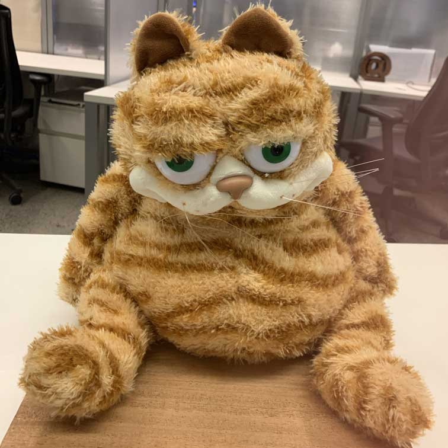

import { Image } from 'astro:assets';
import Video from '../../../components/Video.astro';
import labCat from './LabCatSitsSquareSmall.jpg';
import labCatDraw from './LabCatDraw.mp4';
import labCatSpin from './LabCat3DSpin.mp4';

This page explains how to add a page to the gallery, shows several ways to embed images and
video using the Lab Cat example files, and describes the example pages in the `starter/`
folder. It is written in MDX. Its source is `src/content/gallery/addingpages/index.mdx`.

## Adding a page

### 1. Run the site locally

```sh
npm install      # once
npm run dev      # live preview at http://localhost:4321, updates as you save
```

### 2. Create a folder and a Markdown file

Every `.md` or `.mdx` file under `src/content/gallery/` becomes a page. Give each page its own
folder and keep its images and videos in that folder:

```
src/content/gallery/
  my-project/
    index.mdx          # the page, at /my-project/
    render.png
    turntable.mp4
```

The URL comes from the path. Names are lowercased and spaces become dashes, so
`My Project/index.md` is served at `/my-project/`.

**`.md` or `.mdx`?** Use `.md` for text and images only. Use `.mdx` when you need video or
components. MDX is Markdown plus `import` statements and HTML-like components.

### 3. Add frontmatter

Every page must start with a frontmatter block:

```yaml
---
title: My Ray Tracer                                 # required
description: Soft shadows and glossy reflections.    # required, shown on the page's card
author: Your Name                                    # optional
date: 2026-11-10                                     # optional, newest pages are listed first
thumbnail: ./render.png                              # optional, card image (relative path)
draft: true                                          # optional, hides the page from the site
tldr: One-sentence summary                           # optional, callout at the very top of the page
---
```

`title` and `description` appear on the page's card in the gallery. If a required field is
missing, or `thumbnail` points to a missing file, the build stops with an error that names
the file.

### 4. Group pages into folders (optional)

Any folder of pages becomes a collection page with a card for each page in it, and every page
gets a link back to its folder. To give a folder a title and description, add an `index.md`
directly inside it:

```
src/content/gallery/
  hw1/
    index.md           # title + description for /hw1/
    alice/index.md     # /hw1/alice/
    bob/index.mdx      # /hw1/bob/
```

### 5. Build

Build the static version of the site with:

```sh
npm run build:local    # writes the static site to dist/
```

Then open `dist/index.html` in your browser. No server is needed. Every link in `dist/` is
relative, so you can zip the folder to submit or share it, and it works wherever it's unzipped.

## Embedding images and video

All the examples below use the Lab Cat files stored in this page's own folder:

```
src/content/gallery/addingpages/
  index.mdx                  # this page
  LabCatSitsSquareSmall.jpg
  LabCatDraw.mp4
  LabCat3DSpin.mp4
```

Keep your media next to your page like this. Astro then finds the files at build time,
optimizes images, and generates the correct URLs, even when the site is hosted under a subpath.

## Embedding images

### Markdown image (works in `.md` and `.mdx`)

The simplest option is standard Markdown syntax with a relative path:



```md

```

Astro converts the image to WebP at its original size when it builds the site. That helps
most with large PNG renders. To also shrink an image's dimensions, use `<Image>` as shown below.

### Sized image with a caption (`.mdx`)

For control over size, import the image and use Astro's `<Image>` component. Astro produces
an image at exactly the requested width, so a large render isn't sent to the browser at full
resolution:

<figure class="media">
  <Image src={labCat} alt="Lab Cat sitting" width={320} />
  <figcaption>Lab Cat, sitting very still for a reference photo.</figcaption>
</figure>

```mdx
import { Image } from 'astro:assets';
import labCat from './LabCatSitsSquareSmall.jpg';

<figure class="media">
  <Image src={labCat} alt="Lab Cat sitting" width={320} />
  <figcaption>Lab Cat, sitting very still for a reference photo.</figcaption>
</figure>
```

### Card thumbnail

The same image can be the page's thumbnail on its gallery card. Set it in the frontmatter:

```yaml
thumbnail: ./LabCatSitsSquareSmall.jpg
```

This page does exactly that.

## Embedding video

Video requires an `.mdx` page. Import the video file and the `Video` component at the top of
the file, just below the frontmatter:

```mdx
import Video from '../../../components/Video.astro';   {/* one ../ per folder level below src/ */}
import labCatDraw from './LabCatDraw.mp4';
import labCatSpin from './LabCat3DSpin.mp4';
import labCat from './LabCatSitsSquareSmall.jpg';
```

Astro copies each imported video into the built site and fills in its URL.

### Video with player controls and a poster image

The poster image is shown until the viewer presses play.

<Video src={labCatDraw} poster={labCat} caption="LabCatDraw.mp4: press play" />

```mdx
<Video src={labCatDraw} poster={labCat} caption="LabCatDraw.mp4: press play" />
```

### Autoplaying loop (like a GIF)

Good for turntables and short animations. Autoplaying videos are always muted, because
browsers block autoplay with sound.

<Video src={labCatSpin} caption="LabCat3DSpin.mp4: autoplay + loop" autoplay loop />

```mdx
<Video src={labCatSpin} caption="LabCat3DSpin.mp4: autoplay + loop" autoplay loop />
```

### Without player controls

<Video src={labCatSpin} caption="Same clip, no controls" autoplay loop controls={false} width={320} />

```mdx
<Video src={labCatSpin} caption="Same clip, no controls" autoplay loop controls={false} width={320} />
```

**`Video` options:** `src`, `poster`, `caption`, `controls` (default on), `autoplay`, `loop`,
`muted` (default: on when autoplaying), `width`.

**Format:** MP4 encoded with H.264 plays in every browser. To convert other video with ffmpeg:

```sh
ffmpeg -i input.mov -c:v libx264 -pix_fmt yuv420p -movflags +faststart -an output.mp4
```

Plain `.md` files cannot import video, which is why any page with video needs to be `.mdx`.
You can also serve files from `public/`. The [Example Assets](../starter/example-assets/) page
shows how, but local files are simpler.

## What's in `starter/`

The [Starter Examples](../starter/) folder holds example pages you can copy from. When you
no longer need them, delete `src/content/gallery/starter/` and `public/exampleassets/`. That
`public/` folder is used only by the Example Assets page. This page uses its own copies of the
files.

| Page | Source | What it shows |
| --- | --- | --- |
| [Starter Examples](../starter/) | `starter/index.md` | A folder's own `index.md`: it supplies the title, description, and intro text for the folder's collection page. |
| [Getting Started](../starter/getting-started/) | `starter/getting-started/index.md` | A full walkthrough of the repo: install, run, build, frontmatter, images, video, and where the files live. |
| [Example Assets](../starter/example-assets/) | `starter/example-assets/index.mdx` | The Lab Cat files from `public/exampleassets/`, embedded with `withBase()`. |
| [Hello, Markdown](../starter/hello-markdown/) | `starter/hello-markdown/index.md` + `render.png` | A plain `.md` page with an optimized image next to it, which is also used as the card `thumbnail`. |
| [MDX with Video](../starter/mdx-with-video/) | `starter/mdx-with-video/index.mdx` + `clip.mp4`, `poster.png` | An `.mdx` page that imports a video and poster stored next to it. |
| [Nested Folder](../starter/nested-folder/) | `starter/nested-folder/` (no `index.md`) | A folder without an `index.md`: its title comes from the folder name. |
| [A Nested Page](../starter/nested-folder/nested-page/) | `starter/nested-folder/nested-page.md` | A single-file page (no folder of its own) two levels deep, with a link back to its folder. |
